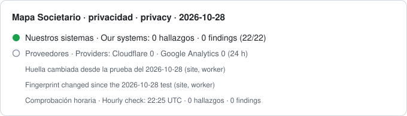

# Mapa Societario: registro diario de privacidad / daily privacy log



[Español](#español) · [English](#english)

## Español

Cada día publicamos aquí una huella de todo lo que decide qué registra [Mapa Societario](https://mapasocietario.es) y el resultado de una revisión de los registros de las últimas 24 horas. Cada entrada incluye el hash de la anterior: la historia no se puede reescribir sin romper la cadena, y GitHub fecha cada día de forma independiente.

> **Estado:** primera entrada el 12 de octubre de 2026, tras la primera prueba completa. Hasta aproximadamente el 11 de noviembre de 2026, nuestro proveedor de red conserva registros de peticiones de versiones anteriores de nuestra web y aplicación que incluyen el nombre de una empresa en la dirección; la revisión diaria los contabiliza bajo `cloudflare:ncdata.eu`, y Google Analytics se revisa con un día de retraso.

### Qué indica cada entrada

| Campo | Significado |
| --- | --- |
| `date` | El día revisado (UTC). |
| `run_at` | Cuándo se ejecutó la comprobación (UTC). |
| `fingerprint` | SHA-256 del conjunto de código y configuración que determina qué se registra (descrito más abajo), tal como estaba desplegado ese día. |
| `baseline_test` | La fecha de la última prueba completa y la huella sobre la que se ejecutó. |
| `unchanged` | `true` cuando la huella de hoy coincide con la de la última prueba completa. |
| `review` | Recuentos de la revisión de los registros de las últimas 24 horas, por almacén. Un `0` en todos significa que ningún registro guarda quién buscó qué. Un almacén que no se pudo leer indica `read: false`; nunca se contabiliza como `0`. En `cloudflare:ncdata.eu`, `refused` cuenta las peticiones con un nombre o una clave en la dirección que la API rechazó, o que el navegador no llegó a enviar; no cuentan como hallazgos. |
| `hourly` | El archivo horario del día anterior que esta entrada ancla: su fecha, su número de líneas y el `entry_hash` de su última línea (ver «Comprobación cada hora»). |
| `prev_hash` | El `entry_hash` de la entrada anterior. |
| `entry_hash` | SHA-256 de esta entrada sin `entry_hash`, con las claves ordenadas. |

Cuando `unchanged` es `false`, el código o la configuración que determinan qué registramos han cambiado desde la última prueba completa. La entrada lo indica y seguirá haciéndolo hasta que se ejecute una nueva prueba completa.

### Qué abarca la huella

- Las líneas de nuestro código desplegado que escriben un registro de las formas que la huella reconoce: líneas de log, eventos de analítica, escrituras en almacenes de datos (bases de datos, almacenes clave-valor, almacenamiento de objetos y cachés) y configuración de registros, en la web, el worker de la API y el backend (todo el código que ejecutan los servicios de nuestro servidor y las propias definiciones de esos servicios: un servicio nuevo cambia la huella). Un registro escrito de otra forma no cambia la huella; la revisión diaria de los registros y la prueba completa lo detectan igualmente, porque leen lo que se ha guardado, no el código.
- La configuración de registros de nuestro servidor: formatos de los registros del servidor web, rotación de registros y configuración de los registros de las aplicaciones y las bases de datos.
- La configuración de servicios externos que podrían registrar datos en nuestro nombre: recogida y conservación de datos de Google Analytics y configuración de registros de Cloudflare.
- El propio comprobador (`checker`): el SHA-256 del programa que hace esta comprobación, que contiene las reglas de detección. Si cambia el comprobador, cambia la huella.

La huella publica hashes, no nuestro código.

### Qué busca la revisión diaria

Los rastros que deja una búsqueda cuando se registra: la dirección de una página de empresa en lugar de un tipo de página, una clave de grupo o una consulta escrita en una dirección almacenada, un término de búsqueda o el nombre de una empresa en los datos de analítica.

### Excepciones publicadas

Fuera de estas seis excepciones, ningún registro guarda qué se consultó junto a quién lo consultó:

1. **Un informe que compras:** el pedido nombra la empresa, para poder prepararlo y entregarlo. Se guarda cifrada en nuestros servidores; una persona de nuestro equipo solo la consulta si el pedido necesita cuentas anuales gestionadas a mano o si nos pides ayuda, y cada consulta queda anotada en el pedido.
2. **Lo que guardas tú:** tus historias se guardan solo en tu navegador, o en el archivo que descargas, y no nos llegan. Las empresas vigiladas y las alertas que activas se guardan en tu cuenta, porque son tuyas por diseño.
3. **Lo que nos envías:** las solicitudes de verificación y los mensajes de contacto contienen lo que escribiste.
4. **Peticiones rechazadas:** las guardamos 90 días como registros de seguridad, con lo que pedían. Nuestro proveedor de red (Cloudflare) anota además durante 31 días cada petición que llega a la API, también las que rechazamos. La revisión diaria las cuenta aparte (`refused`).
5. **Contadores del límite de uso del día:** huellas con clave (HMAC-SHA-256) de lo abierto hoy, nunca nombres. La clave cambia cada día UTC y se borra al acabar el día con el contador; Cloudflare puede recuperar ese almacenamiento hasta 30 días.
6. **El recuento de demanda**, que decide qué páginas de empresa mostramos a los buscadores: por cada empresa, el número de días (UTC) en que la abrieron al menos tres visitantes distintos, y el mes del primero. Ni quién, ni a qué hora, ni una serie por días.

### Comprobación cada hora (nuestros sistemas)

Además de la revisión diaria, cada hora (a las :25 UTC) un programa compara la huella de nuestros cinco componentes (web, worker de la API, backend, configuración del servidor y el propio comprobador) con la de la última prueba completa, y revisa nuestros propios registros (eventos de analítica y registros del servidor) desde la comprobación anterior. Cada hora añade una línea a `hourly/<fecha>.jsonl`, encadenada con la anterior y, la primera, con la entrada diaria de ese día; la entrada diaria siguiente ancla el archivo. Los registros de nuestros proveedores se siguen revisando una vez al día.

Las líneas horarias se publican durante el día; su protección con marcas de tiempo llega con el anclaje de la entrada diaria siguiente.

### Líneas base

`baseline.json` es la última prueba completa: su fecha, su huella, las huellas de cada componente y el motivo del cambio (`reason`). Cada línea base queda además en `baselines/<momento>.json`, que nunca se sobrescribe: el historial de cuándo y por qué cambió la línea base es público.

### Marcas de tiempo (RFC 3161)

Cada entrada diaria lleva marcas de tiempo de dos autoridades independientes, FreeTSA y DigiCert, sobre su `entry_hash`, en `timestamps/<fecha>.<autoridad>.tsr`. Una marca de tiempo certifica que esa huella existía en ese momento; no certifica el contenido de la entrada ni que haya 0 hallazgos. Sirve para que nadie, tampoco nosotros, pueda presentar más tarde un informe distinto como si hubiera existido antes. Solo sale de nuestro servidor la huella. Si una autoridad no responde, se vuelve a pedir en los días siguientes (hasta 7).

Los certificados raíz están en `timestamps/certs/`; compara su huella SHA-256 con la que publica cada autoridad:
- FreeTSA Root CA: `A6:37:9E:7C:EC:C0:5F:AA:3C:BF:07:60:13:D7:45:E3:27:BB:BA:A3:8C:0B:9A:F2:24:69:D4:70:1D:18:AA:BC`
- DigiCert Trusted Root G4: `55:2F:7B:DC:F1:A7:AF:9E:6C:E6:72:01:7F:4F:12:AB:F7:72:40:C7:8E:76:1A:C2:03:D1:D9:D2:0A:C8:99:88`

### Copias independientes

Tras cada publicación diaria pedimos a Software Heritage que guarde este repositorio y al Internet Archive que guarde la entrada del día. Son copias que no controlamos, con las que se puede comparar lo publicado.

### Cómo verificar la cadena

```sh
node verify.mjs
```

El programa vuelve a calcular cada `entry_hash` y comprueba que cada `prev_hash` coincide con el de la entrada anterior. Requiere Node 18 o posterior, sin dependencias. Una cadena íntegra muestra que las entradas no se han alterado respecto a una copia que hayas guardado antes; quien controle el repositorio podría recalcular una cadena entera, y por eso conviene comparar con una copia anterior.

Para comprobarlo todo:

```sh
node verify-evidence.mjs
```

Comprueba la cadena diaria, cada archivo horario anclado (y el del día en curso), cada marca de tiempo con `openssl ts -verify` contra los certificados de `timestamps/certs/`, y que `baseline.json` es la última del historial. Nombra los días sin marca de tiempo. Requiere Node 18 o posterior y openssl.

Estas comprobaciones las opera Mapa Societario. Cualquiera puede verificar la integridad y las marcas de tiempo de los informes publicados; esa verificación no demuestra por sí sola que se haya revisado cualquier lugar donde algo pudiera registrarse. Por eso publicamos qué cubre cada comprobación y qué no.

Contacto: mapasocietario@ncdata.eu · Nurnberg Consulting SL

---

## English

Every day we publish here a fingerprint of everything that decides what [Mapa Societario](https://mapasocietario.es) records, and the result of a review of the last 24 hours of records. Each entry carries the hash of the previous one: the history cannot be rewritten without breaking the chain, and GitHub timestamps each day independently.

> **Status:** first entry 12 October 2026, after the first full test. Until about 11 November 2026 our network provider still holds request records from older versions of our site and app that name a company in the address; the daily review counts them under `cloudflare:ncdata.eu`, and Google Analytics is reviewed a day late.

### What an entry says

| Field | Meaning |
| --- | --- |
| `date` | The day checked (UTC). |
| `run_at` | When the check ran (UTC). |
| `fingerprint` | SHA-256 of the recording surface (below), as deployed that day. |
| `baseline_test` | The date of the last full test, and the fingerprint it ran against. |
| `unchanged` | `true` when today's fingerprint equals the one the last full test ran against. |
| `review` | Counts from the 24-hour review of our records, per store. `0` everywhere means no record keeps who searched what. A store that could not be read says `read: false`; it never counts as `0`. In `cloudflare:ncdata.eu`, `refused` counts requests with a name or key in the address that the API refused, or that the browser never sent; they do not count as findings. |
| `hourly` | The previous day's hourly file this entry anchors: its date, its number of lines and its last line's `entry_hash` (see “Hourly check”). |
| `prev_hash` | `entry_hash` of the previous entry. |
| `entry_hash` | SHA-256 of this entry without `entry_hash`, keys sorted. |

When `unchanged` is `false`, the code or settings that decide what we record have changed since the last full test. The entry says so, and stays that way until a new full test has run.

### What the fingerprint covers

- The lines of our deployed code that write a record in the ways the fingerprint recognises: log lines, analytics events, data-store writes (databases, key-value stores, object storage, caches) and logging configuration, in the website, the API worker and the backend (all the code our server's services run, and the service definitions themselves: a new service changes the fingerprint). A record written some other way does not change the fingerprint; the daily review of the records and the full test still find it, because they read what was stored, not the code.
- The logging configuration of our server: web server log formats, log rotation, application and database log settings.
- The settings of outside services that could record on our behalf: Google Analytics data collection and retention, Cloudflare log settings.
- The checker itself (`checker`): the SHA-256 of the program that runs this check, which holds the detection rules. If the checker changes, the fingerprint changes.

The fingerprint publishes hashes, not our code.

### What the daily review looks for

The shapes a search leaves when it is recorded: a company page address instead of a page type, a group key or a typed query in a stored address, a search term or a company name in analytics.

### Published exceptions

Outside these six exceptions, no record keeps what was looked up together with who looked it up:

1. **A report you buy:** the order names the company, so that the report can be prepared and delivered. It is stored encrypted on our servers; a person on our team looks at it only if the order needs annual accounts handled by hand or you ask us for help, and every look is recorded in the order.
2. **What you save yourself:** your stories are kept only in your browser, or in the file you download, and never reach us. The companies you monitor and the alerts you switch on are kept in your account, because they are yours by design.
3. **What you send us:** verification requests and contact messages hold what you wrote.
4. **Refused requests:** we keep them for 90 days as security records, with what they asked for. Our network provider (Cloudflare) also notes, for 31 days, every request that reaches the API, including the ones we refuse. The daily review counts them apart (`refused`).
5. **Today's usage-limit counters:** keyed fingerprints (HMAC-SHA-256) of what was opened today, never names. The key changes every UTC day and is deleted with the counter at the end of the day; Cloudflare can restore that storage for up to 30 days.
6. **The demand tally**, which decides which company pages we show to search engines: for each company, the number of UTC days on which at least three distinct visitors opened it, and the month of the first. Not who, not when in the day, no day-by-day series.

### Hourly check (our systems)

In addition to the daily review, every hour (at :25 UTC) a program compares the fingerprint of our five components (website, API worker, backend, server configuration and the checker itself) with the last full test, and reviews our own records (analytics events and server logs) since the previous check. Each hour adds one line to `hourly/<date>.jsonl`, chained to the line before and, for the first, to that day's daily entry; the next daily entry anchors the file. Our providers' records are still reviewed once a day.

Hourly lines are published during the day; their timestamp protection arrives with the next daily entry's anchor.

### Baselines

`baseline.json` is the latest full test: its date, its fingerprint, each component's hash and the reason for the change (`reason`). Every baseline is also kept in `baselines/<when>.json`, never overwritten, so the history of when and why the baseline changed is public.

### Timestamps (RFC 3161)

Every daily entry carries timestamps from two independent authorities, FreeTSA and DigiCert, over its `entry_hash`, in `timestamps/<date>.<authority>.tsr`. A timestamp certifies that the hash existed at that time; it does not certify the entry's content or that there were 0 findings. It means nobody, including us, can later present a different report as if it had existed earlier. Only the hash leaves our server. If an authority does not answer, it is asked again on the following days (up to 7).

The root certificates are in `timestamps/certs/`; compare their SHA-256 fingerprints with those each authority publishes:
- FreeTSA Root CA: `A6:37:9E:7C:EC:C0:5F:AA:3C:BF:07:60:13:D7:45:E3:27:BB:BA:A3:8C:0B:9A:F2:24:69:D4:70:1D:18:AA:BC`
- DigiCert Trusted Root G4: `55:2F:7B:DC:F1:A7:AF:9E:6C:E6:72:01:7F:4F:12:AB:F7:72:40:C7:8E:76:1A:C2:03:D1:D9:D2:0A:C8:99:88`

### Independent copies

After each daily publish we ask Software Heritage to save this repository and the Internet Archive to save the day's entry. They are copies we do not control, which what is published here can be compared with.

### Verify the chain

```sh
node verify.mjs
```

It recomputes every `entry_hash` and checks that each `prev_hash` matches the entry before it. Node 18 or later, no dependencies. An intact chain shows that the entries have not been altered relative to a copy you kept earlier; whoever controls the repository could recompute a whole chain, which is why comparing with an earlier copy matters.

To check everything:

```sh
node verify-evidence.mjs
```

It checks the daily chain, every anchored hourly file (and the current day's), every timestamp with `openssl ts -verify` against the certificates in `timestamps/certs/`, and that `baseline.json` is the latest in the history. It names any day without a timestamp. Node 18 or later and openssl.

These checks are operated by Mapa Societario. Anyone can verify the integrity and the timestamps of the published reports; that verification does not by itself establish that every possible logging location was inspected. That is why we publish what each check covers and what it does not.

Contact: mapasocietario@ncdata.eu · Nurnberg Consulting SL
